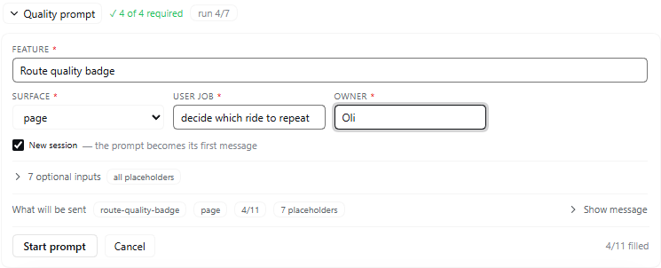
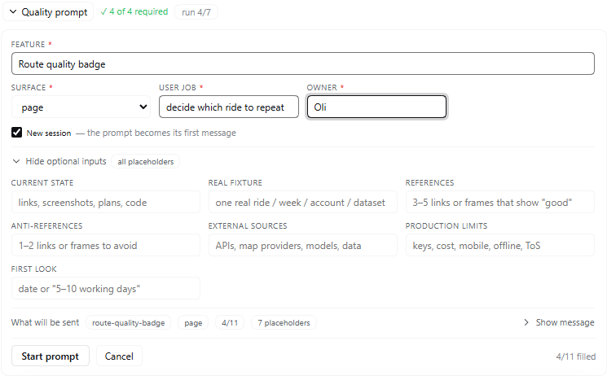
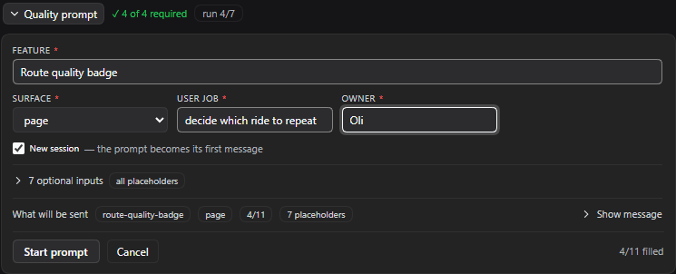

# Evaluation — the Generic Feature Quality Prompt, delivered by `/quality`

**Question (v1).** Delivering the prompt through a slash command and a composer
form is not how it was written. It was written to be copied, filled, and pasted as
the first message of a new session. Does the plugin deliver *the asset* — or a
version of it?

**Verdict (v1).** The delivery is the asset: outside the Inputs block the message
is byte-identical to `prompt.md` for every fixture.

**Question (v2).** Three things changed after v1: the text was revised, the
command gained required inputs and a closed SURFACE vocabulary, and the delivery
grew a preview, a run record and an evidence scan. Does v2 still deliver the
asset, and are its new rules true in both entry points?

**Verdict (v2).** Yes, and the gate that used to pass on Linux and fail on
Windows now passes on both — because the failure it was blind to was fixed, not
because the check was relaxed.

- Artifact: this report.
- Reproduce: `node eval/harness.mjs` and `node eval/wiring.mjs` (exit 1 = gate not
  met).
- Fixtures: [`eval/fixtures.json`](fixtures.json) — full, real-partial, empty,
  minimum, surface-combo, typo.

## Method

The delivery lab renders the message the plugin would submit for each fixture and
diffs it against `prompt.md` line by line, **outside** the Inputs block. The
contract says the tool owns the Inputs values and nothing else, so any line it
writes elsewhere is a defect by construction — no judgement needed. It adds the
checks a green run must not be able to fake:

- the `UNFILLED:` line names exactly the fields that are unfilled, one line, and
  only when something is unfilled;
- a CRLF template, a lone-CR template and a mixed one deliver text identical to
  the LF template, and no `\r` reaches the model;
- no `{{TOKEN}}` survives into the message;
- every deliverable path in `lib/state.mjs` is named in `prompt.md`, so the scan
  cannot tick a file the prompt never asked for.

The wiring lab drives `apply()` against a stub context (both commands, all three
routes, auth, refusals, the run record, the evidence scan) and then runs the
control under a hook runtime — open, fill, preview, submit, refusal, and the
"route did not register" answer. It also compares the client's field table with
the host's, so the two cannot drift.

Behavioural evidence for v1 came from the run already launched by hand: session
`0e4299a8-a6af-488c-a734-934d9fa10f42`, 336 events, decoded and read directly.

## What v1 found

**F1 — The delivery edited the asset.** Two lines were written *in front of* the
prompt, on every partial fill. The full-fill path was clean; the path actually
taken was not.

**F2 — The edit was load-bearing, not cosmetic.** The model's first reasoning
opens by quoting it. "Owner-owned" is a category the prompt does not contain, and
a paraphrase in front of a proven document is what the prompt's own first rule
forbids.

**F3 — Partial input is the default, and the prompt assumes the opposite.** 6 of
11 fields were supplied; `SURFACE` received a URL where the prompt accepts
page / flow / API / algorithm / integration.

**F4 — The ritual survived delivery.** The run produced diagnosis, quality
contract, artifact and Phase 0 language. The mechanism is sound.

The v1 change moved the placeholder signal into the Inputs block and dropped its
instruction clause:

```
UNFILLED:           REFERENCES, ANTI-REFERENCES, EXTERNAL SOURCES, FIRST LOOK, OWNER
```

It is data, not a rule. With every field supplied, no line is added at all.

## v1's open item, and what v2 did with it

v1 left open whether the model still treats placeholders correctly once the
pointer is gone, and named the fallback: **require fields before submit**.

v2 takes the middle path the evidence supports. Four inputs gate submission —
FEATURE, SURFACE, USER JOB, OWNER — because without them there is no run to
diagnose (who is trying to do what, on which surface, accountable to whom). The
other seven remain placeholders, and Phase 0 is explicitly given the job of
resolving them, with an unresolved one recorded in `DECISIONS.md` rather than
invented. That is a rule change in the asset, not just in the launcher, so the
prompt states it in the Inputs preamble.

## What v2 found

**F5 — The gate was red on Windows, and green in CI.** `prompt.md` is CRLF on a
Windows checkout (`core.autocrlf=true`). `index.js` matched the block as the
literal `'Inputs\n```\n'` and `eval/harness.mjs` matched it again; neither
matched, so `appendInputsLine` silently returned the text unchanged and the
`UNFILLED:` line was dropped. The lab's own splitter failed the same way, which
is why the three fixtures reported 22 changed lines outside the block instead of
the real 0. Two implementations of one contract, no test that could see the
difference.

The fix is one shared module (`lib/template.mjs`) that normalises newlines before
matching, a template validated at activation (a missing block is now an error, not
a no-op), and three cross-platform checks in the delivery lab. The `UNFILLED:`
line is the prompt's only signal that a placeholder survived; losing it silently
was the same class of defect as F1.

**F6 — The form could submit what the command refused.** The v1 control let any
fields be blank and posted a line the command would have accepted; adding a
required set in only one place would have recreated F3 from the other side. Both
entry points now call the same validation, and the wiring lab asserts the route
refuses what the command refuses.

**F7 — A closed vocabulary without a closed form invites the real failure.** The
real run put a URL in SURFACE. The command now canonicalises aliases and refuses
anything else with the list and the right field; the form offers the five values
as a select, so the URL cannot be typed there at all. A combination (`page + API`)
is still accepted from the command; the form offers one surface.

**F8 — Progress that is not evidence is a lie.** A phase counter that advances
because a run started would repeat the thing the prompt forbids. The status scan
reports only files it found, names the path it looked at, and says that P0 has no
file of its own. `/quality-status` and the run strip render the same scan.

## Result

| fixture | supplied | outsideΔ | inputsΔ | verdict |
|---|---|---|---|---|
| full | 11/11 | 0 | 0 | pass |
| partial-real | 6/11 | 0 | 1 | pass |
| empty | 0/11 | 0 | 1 | pass |
| minimum | 4/11 | 0 | 1 | pass |
| surface-combo | 4/11 | 0 | 1 | pass |
| typo | 4/11 | 0 | 1 | pass |

Plus: CRLF/CR/mixed templates byte-identical, 11 tokens each present once, 7
deliverable paths declared, 16 host checks, 4 scan checks, 11 client interaction
checks (69 assertions in all). Both labs exit 0.

## Looked at it

The lab renders the component; it cannot see the composer. A disposable web
profile (`dsh fqcheck --from-default-profile web`, plugin linked in, port 59041)
was driven with Edge through Playwright, so the control was exercised in the real
application shell against the real host routes:

- `/plugins/feature-quality/status` → `200 {"ok":true,"found":false,…}` and
  `/preview` → `200`, with the block naming the missing USER JOB and OWNER.
- The panel opened, showed `Fill 4 required` with four required marks, and
  enabled `Start prompt` once the four were there.
- The message was built by the host and rendered in full: 16,416 characters, with
  `FEATURE:            Route quality badge` and the `UNFILLED:` line.
- The draft was in `localStorage`.

**F9 — `found: false` crashed the open panel, and the lab could not see it.**
`/status` answers "no run recorded yet" with `found: false` and no `slug`. The
open panel read `slug.toUpperCase()`; the slot threw
`TypeError: Cannot read properties of undefined (reading 'toUpperCase')` and the
dock entry vanished out of the composer — on the first open, on a fresh profile.
Every lab fixture supplied a run, so the missing branch was green until a browser
reached it. Fixed in the component (guard on `found`), and the wiring lab now has
the fixture that fails without the fix ("opens when no run has been recorded yet").

The same run found the second layout defect: with the message open the panel
scrolled, and the action buttons scrolled out of sight. The panel body now
scrolls and the footer is pinned.

## v3 — the UI pass

The launcher looked like a form: eleven equal fields, a wall of message text, and
the action buttons below the fold. What it is, is a decision — four inputs start
it, the other seven are Phase 0's work — so the panel now says that.

- Required four first, FEATURE full width, a header meter (`✓ 4 of 4 required`),
  and a gap line that disappears when it is met.
- The seven placeholder-friendly inputs are behind `7 optional inputs`, which
  counts what is filled.
- The message is summarised (`slug · surface · supplied · placeholders`) and shown
  in full only on request; opening the run details closes the message, so neither
  opens underneath the other.
- A brand focus ring, a themed scrollbar in the scroll body, and a 120ms settle
  on open that respects `prefers-reduced-motion`.
- `auto-fit` grids measured, not assumed: three 219px tracks at a 705px dock, two
  173px tracks at 383px, with the message summary wrapping instead of truncating
  its pills. The first version truncated them to `feat…` / `11 placehol…` at phone
  width — the pills were shrinkable flex items, so `flexShrink: 0` plus
  `flex-wrap` on the row is what makes the wrap possible.

Contact sheet: `eval/screenshots/` (rendered from a disposable `dsh web` profile
through Edge, states: pristine, filled, optional, message, run, dark, plus a
390px and a 768px measurement pass).






**F10 — the lab cannot see layout.** The first render of the run panel clipped the
message box to about 16px: the panel body is a flex column, so its children shrank
instead of scrolling. `flexShrink: 0` on the body's children is the fix and a
comment in the styles says why. Every interaction check was green while this was
broken.

**F11 — a run record with a BOM reads as no run.** A shell-written fixture carried
a byte-order mark; `JSON.parse` throws, `readRun` swallowed it, and `/quality-status`
reported "no run recorded yet" for a run that existed. The reader now strips the
mark and the wiring lab has the fixture.

**F12 — the new-session path was missing a required argument, and the stub hid
it.** `sessionController.prompt(request, signal)` calls `signal.throwIfAborted()`
as its first act. The route passed one argument, so the default "Start in a new
session" path failed on every submit with `Cannot read properties of undefined
(reading 'throwIfAborted')` — surfaced in the composer as "The prompt could not
be submitted (…)". The route now passes one signal to both admission and
dispatch, and the stub models the real arity: it throws without a signal, so the
check fails the way the app did. The current-session path had always been fine,
which is why a real submission succeeded while the default path did not.

## v4 — presets, and what was refused

Four defaults were proposed. One survived evaluation; the other three were
replaced or dropped, because each one would have made the delivered prompt worse
than the blank it replaced:

| Proposed | Verdict | Replacement |
|---|---|---|
| `OWNER: you` | "you" is the *agent* in the delivered prompt; `OWNER: you` in `CONTRACT.md` names nobody a week later | `OWNER: Oli` |
| `REAL FIXTURE: real prod data` | a category, not a fixture — it satisfies the field while giving Phase 0 nothing to open, and it suppresses the `UNFILLED:` line that asks for one | left blank |
| `PRODUCTION LIMITS: unlimited time and scope` | contradicts the prompt's own non-negotiable, "you do not have unlimited scope" | `unlimited time, not scope` |
| `FIRST LOOK: as long as it takes` | removes the checkpoint the prompt keeps on purpose | `5 working days` |

**F13 — a preset keyed by its label was silently ignored.** `defaults.json`
first said `"FIRST LOOK"`; the field key is `FIRST_LOOK`. `parseDefaults` warned
and ignored it, which is the right behaviour but was invisible — the lab asserted
only that OWNER arrived. The check now requires both presets, so a key that does
not exist fails instead of quietly shrinking the file.

**F14 — the preset mark had to be derived, not remembered.** Marking keys as the
file arrives showed a `preset` badge over an empty field when a stored draft had
blocked the fill. The mark is now computed from the value: preset **and**
unchanged. Typing drops it, clearing drops it, a draft never gets it.

The client's hook runtime also learned to re-render on state the way React does,
because four preset checks read the tree after an awaited request and saw the
pre-request frame.

**F15 — the session was created, and invisible.** `sessionController.create`
makes a real session on disk with the prompt queued, but the app's client-side
session store never hears about it: the main pane stayed on the old
conversation and the sidebar did not list the new one, so "Start in a new
session" looked like it had done nothing. Confirmed from the store —
`session-357452a4…` existed with a 56 KB turn already running in it.

Two dead ends first: the web app keeps one URL for every session (no route to
navigate to), and `__DSH_BOOT__` exposes only module entries. The supported path
is the service the sidebar itself calls: `uiWorkspace.openSession(sessionId)`.
The control now hands the created id to it, guarded — if the service is missing
the receipt still says where the session is — and the unit stub models
`uiWorkspace` so the check fails if the call is dropped. Verified live: a submit
in a disposable harness switched the pane to the new session, which displayed
`Generic Feature Quality Prompt`, with the old conversation left behind. The
receipt is not seen in that case because the control remounts inside the new
session; its own run badge (`run 0/7`) is what appears instead.


## v5 — the tools

Every quality run was rebuilding the same two things: a contract shaped like the
prompt's Phase 1 block, and a way to look at more than one frame. That is the
work the tools take over.

| Tool | What it is for |
|---|---|
| `quality.mjs new` | Writes `CONTRACT.md`, `REFERENCE.md`, `DECISIONS.md` and the lab harness, slugged from the feature, with the owner filled. |
| `quality.mjs check` | The mechanical gate: eight contract fields filled, reference and decisions present, one artifact rendered. Exit 1 otherwise. |
| `quality.mjs status` | The same scan `/quality-status` prints, for a shell. |
| `contact-sheet.mjs` | Frames in, one labelled page out — laid out by a real browser, so no image library and no per-run screenshot script. |
| `templates/states.mjs` | Per-feature states, shared plumbing: URL, viewports, naming, sheet. |

What they deliberately are not: not an MCP server (the plugin is in-process
already), not a visual-regression service (the gate is a human look), not a
wrapper that calls the model, and not a harness that knows the app — every
feature's states are its own.

**F16 — the gate demanded `PRODUCTION.md`.** It is Phase 6 and exists only when a
run passes, so the first version of `check` could never go green: a gate that is
red until the end is a gate nobody reads. It is now reported and not gated, which
matches the prompt's own definition of done.

**F17 — `repoRoot()` was one level short.** From `tools/` it walked three
directories up, landing in `.dsh` instead of the repository; every browser tool
failed with "Playwright is not installed" while it sat in `frontend/node_modules`.
Found by running the contact sheet, not by reading it.

The CLI's paths come from `lib/state.mjs` — the module the plugin's own scan
uses — so the two cannot disagree, and `eval/tools.mjs` asserts it.

## Rejected

- **Keep the preamble and document it as an exception.** Rejected: the model
  obeyed the addition, so the exception would be permanent and silent.
- **Require all eleven fields.** Rejected: the prompt's own "When to ask" list is
  the interview, and a seven-field interview before Phase 0 blocks the work that
  would answer the questions.
- **Let a missing block degrade open** (deliver the prompt with no marker).
  Rejected: v1's defect was exactly that silence. Activation fails instead.
- **Advance the phase counter on submit.** Rejected: F8.
- **Deliver into a new session by default on the command path.** Rejected: the
  command runs in the session you typed it in; only the control's checkbox
  creates a session, and it says so.
- **A free-text SURFACE input with a datalist.** Rejected for the form: the real
  failure was a URL and a select cannot produce one. The command keeps free text
  so combinations stay expressible.
